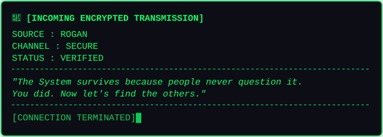

# MXR

<table align="center">
  <thead>
    <tr>
      <th align="left">System / Metadata</th>
      <th align="left">Repository Metrics</th>
      <th align="left">Connection &amp; State</th>
    </tr>
  </thead>
  <tbody>
    <tr>
      <td></td>
      <td></td>
      <td></td>
    </tr>
    <tr>
      <td></td>
      <td></td>
      <td></td>
    </tr>
    <tr>
      <td></td>
      <td></td>
      <td></td>
    </tr>
  </tbody>
</table>

---

## About

**MXR** is a terminal-based role-playing game set in a universe inspired by *The Matrix*.

You play as an **Operator** working for the mysterious resistance figure known as **ROGAN**. Once a small-time hacker, your life changed forever when you discovered the truth: the world you inhabit is nothing more than a carefully constructed simulation.

Operating through **LindOS**, a fictional operating system that combines the best aspects of Linux and Windows, you infiltrate networks, uncover secrets, complete missions, and search for individuals ready to awaken from the illusion surrounding them.

But the System watches everything.

Every connection leaves a trace.

Every action has consequences.

And not everyone wants to be saved.

---

## Features

- Terminal-driven gameplay
- Retro-inspired LindOS desktop environment
- Story-rich missions
- Matrix-inspired cyberpunk universe
- Branching narrative decisions
- Hidden secrets and easter eggs
- Modular mission system
- Community-created content support
- Persistent save system
- Hacking and infiltration mechanics

---

## Story

Years ago you were nothing more than a criminal hacker.

Then you met **ROGAN**.

ROGAN revealed a truth hidden from nearly everyone: reality itself is a simulation maintained by powerful systems of control.

Now you operate in the shadows, helping people awaken while evading the security systems designed to keep them trapped.

Every mission brings you closer to uncovering the true nature of the System.

Every discovery raises new questions.

And somewhere beyond the code lies a truth few have ever seen.

---

## LindOS

LindOS is the primary interface used throughout MXR.

Features include:

- Terminal Interface
- Virtual File System
- Mission Board
- Secure Messaging
- Digital Archives
- Network Scanner
- Save Management
- Developer-Friendly Modding Support

---

## Commands

```bash
help                Display available commands
cls                 Clear the terminal
start               Start a new game
load <save_name>    Load an existing save
settings            Open settings
info                Display game information
quit                Exit LindOS
```

---

## Modding

MXR is designed from the ground up to be modular.

Future versions will allow players to create:

- Custom Missions
- Custom Story Campaigns
- New Factions
- New Characters
- Additional LindOS Applications
- Custom Events
- Complete Total Conversions

Most game content will be data-driven to allow community expansion without modifying the core game.

---

## Current Status

```text
STATUS: ALPHA 0.1

✔ Core Terminal Framework
✔ Command System
✔ LindOS Boot Sequence
✔ BIOS & Boot Manager
✔ Main Menu Terminal

⬜ Mission System
⬜ Save System
⬜ Network Simulation
⬜ Story Campaign
⬜ Email System
⬜ Modding Toolkit
⬜ Achievement System
```

---

## Screenshots

```text
[Screenshots Coming Soon]
```

---

## Development Roadmap

### Alpha 0.1
- Terminal Framework
- LindOS Main Menu
- Boot Process Simulation

### Alpha 0.2
- Mission Framework
- Save Management
- Network Nodes

### Alpha 0.3
- Story Campaign
- ROGAN Mission Chain
- Secure Messaging

### Beta
- Modding Support
- Multiple Campaigns
- Expanded LindOS Applications

### 1.0
- Complete Story
- Full Mission System
- Community Content Support

---

## Credits

Created by **Vibrantic**

Inspired by classic hacking games, cyberpunk fiction, and the ideas popularized by *The Matrix*.

---

<p align="left">
  
</p>
